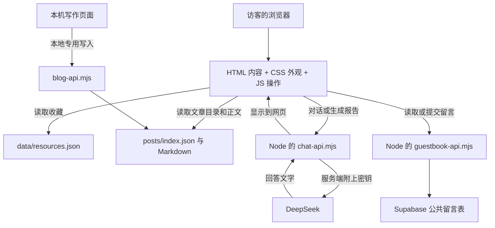

# 找文件，就像按门牌号找房间

项目根目录是 `E:\chatGPTproject\neon-lab`。以下文件名均相对于这个目录。第一次不用全部打开，先认识五个页面和两个内容文件夹。

## 访客怎样走

```text
首页 index.html：旋转地球，选择两个目的地
├── 嵌入式 embedded.html
│   ├── GitHub 链接
│   ├── 三个 Arduino 示例 → arduino-viewer.html
│   ├── 资料收藏
│   └── 实验日志 → blog.html
└── 英语沙龙 english.html
    ├── 本地练习 / AI 对话
    ├── AI 练习报告
    ├── 英语资料收藏
    └── 匿名昵称留言
```

实验日志仍是独立文章页，但入口整合在嵌入式页面。当前首页只有两个目的地，不再有第三个“实验日志”选项。右上角导航已移除，主要页面的左上角网站名可以返回首页。

## 主要文件分工

```text
neon-lab/
├── index.html                 首页的内容与入口
├── embedded.html              工作室、项目、资料、日志入口
├── english.html               英语对话、报告、留言的界面
├── blog.html                  文章列表、文章阅读、写作界面
├── arduino-viewer.html        Arduino 风格代码预览
├── planet.js                  星球绘制与目的地切换
├── app.js                     英语页共用的小工具与本地存储封装
├── resources.js               读取收藏与实验日志目录
├── lounge.js                  聊天、话题、练习报告
├── guestbook.js               留言表单与光弧显示
├── blog.js                    文章显示与写作操作
├── arduino-viewer.js          读取、着色、复制、下载示例代码
├── styles.css                 全站基础样式
├── spark.css                  多轮改版积累的品牌与页面样式
├── orbit.css                  现版首页、嵌入式样式
├── salon.css                  现版沙龙、报告与光弧留言样式
├── blog.css                   现版博客样式
├── arduino-viewer.css         代码预览样式
├── server.mjs                 本地 / 线上服务器入口
├── chat-api.mjs               AI 配置状态、对话与报告接口
├── guestbook-api.mjs          公共留言接口
├── blog-api.mjs               只允许本机使用的文章写入接口
├── data/resources.json        要展示的收藏链接
├── posts/
│   ├── *.md                   文章正文
│   └── index.json             文章目录，由脚本生成
├── examples/                  三个 Arduino 示例的 .ino 文件
├── assets/                    背景、人物插画、地球贴图等
├── scripts/
│   ├── build-posts.mjs        重建文章目录
│   └── post-utils.mjs         解析文章开头资料等工具
├── supabase/guestbook.sql      公共留言表、权限与写入规则
├── tests/                     聊天与留言接口的模拟测试
├── notes/                     历次设计笔记，可能描述旧版本
├── docs/入门开发手册/           你正在读的新说明
├── package.json               项目版本、命令与 Node 要求
├── render.yaml                Render 部署配置
├── .env.example               配置表的空白样本
├── .env                       本机真实配置，不应提交
└── .gitignore                 告诉 Git 哪些文件不要收进去
```

这是主要文件地图，不是所有文件清单。`learning.js`、`studio.js` 等旧功能代码仍在仓库中，不能因为文件存在就推断当前页面在使用它。判断一个页面加载了什么，先看 HTML 的 `<script src="…">` 和 `<link rel="stylesheet" href="…">`。

英语页的 `lounge.js` 会使用 `app.js` 提供的 `$` 和 `storage`。`$` 是帮助查找页面元素的小函数，`storage` 帮忙读写浏览器本地数据。因此不要看到 `app.js` 里有一些旧页面逻辑，就把整份文件或它的加载标签直接删掉。

## 想改东西时，先查这张表

| 你的想法 | 首先打开 | 再检查什么 |
| --- | --- | --- |
| 改首页那句介绍 | `index.html` | 桌面和手机换行是否自然 |
| 调整首页背景、字体间距 | `orbit.css` | 是否误影响嵌入式页面 |
| 改星球目的地 | `planet.js` 的 `destinations`，以及 `index.html` 按钮 | 两边数量、顺序、链接一致 |
| 加一条收藏 | `data/resources.json` | JSON 格式与链接是否正确 |
| 写一篇心得 | `posts/新文件.md` | 运行目录生成脚本 |
| 改项目展示文字 | `embedded.html` | 代码预览入口仍指向正确示例 |
| 加一个代码预览示例 | `arduino-viewer.js` 的 `EXAMPLES` | 源码文件、入口、服务器文件名单都要配合 |
| 改英语话题开场句 | `lounge.js` 的 `rooms` | 本地模式与 AI 模式是否区分清楚 |
| 改 AI 的指导要求 | `chat-api.mjs` | 会影响模型回答，应先用少量对话检查 |
| 改留言外观 | `salon.css` 与 `guestbook.js` | 显示变化不等于数据库规则变化 |

## 一个页面为什么加载好几份 CSS

网站是逐轮修改出来的，旧基础规则与新规则叠加使用。首页目前按顺序加载 `styles.css → spark.css → orbit.css`；嵌入式也是这三份。英语页还加载 `atmosphere.css`、`worlds.css`、`spaces.css`、`learning.css`，最后有 `salon.css`；其中 `spark.css` 目前重复引用了一次。

这可以正常工作，但会增加找样式的难度。CSS 不是简单的“最后一行永远赢”：还会比较规则是否匹配、优先级和 `!important`。规则条件相当时，后面的通常覆盖前面的。

以后适合做一次样式整理；本次暂停开发，所以只记录，没有借整理文档顺手重构。你学习时，可以先读样式表中的一小段，再用浏览器 F12 的“元素 / 样式”查看实际生效规则。[MDN：CSS 基础](https://developer.mozilla.org/zh-CN/docs/Learn_web_development/Core/Styling_basics)

## 运行流程图：谁把东西交给谁



文字读法：资料和文章主要来自文件；聊天交给 AI 服务；公共留言交给数据库；博客直接写入文件的接口只在本机开放。托管在 Render 时，`server.mjs` 也负责把页面、图片等文件交给浏览器。

## API 地址小字典

GET 可以先理解为“来拿一份东西”；POST 是“递交材料，请处理”。

| 方法与地址 | 谁使用 | 做什么 | 怎样算成功 |
| --- | --- | --- | --- |
| `GET /api/status` | 英语页 | 检查 AI 配置是否齐全 | 返回 `configured`；不是一次真实模型连通测试 |
| `POST /api/chat` | 英语页 | 请求一次 AI 回复 | 返回 `reply` 字符串 |
| `POST /api/report` | 英语页 | 总结本房间对话 | 返回 `report` 字符串 |
| `GET /api/guestbook` | 留言板 | 读取公开留言，后端最多取最近 50 条 | 返回 `messages` 数组，前端另有显示上限 |
| `POST /api/guestbook` | 留言板 | 保存昵称与留言 | 数据库确认后返回成功 |
| `POST /api/posts` | 本机博客写作 | 新建 Markdown 并更新目录 | 返回新文章的 `slug` 与地址 |

`slug` 是文章的文件标识。例如 `2026-11-23-first-blink` 对应 `posts/2026-11-23-first-blink.md`，读文章的地址使用 `blog.html#post/2026-11-23-first-blink`。

## 为什么文件放进去，有时网址却打不开

当前 `server.mjs` 有一张允许访问的文件名单 `files`。它不会把整个硬盘或项目文件夹随便交给访客。新加的图片、PDF、独立 HTML，若没有登记到名单里，在 Node 网站上可能得到 404。

文章走单独的 `/posts/` 规则，因此 `posts/` 中合规命名的 Markdown 可以被读取，不需要逐篇登记。新手优先使用英文字母、数字和连字符命名。

这也意味着：把一个笔记放在 `notes/` 里，并不等于它有网站访问地址；把文件放进 GitHub 公开仓库，则又是另一种公开方式。不要把网站的访问名单误当成仓库隐私保护。

## 代码预览页并不是 Arduino IDE

`arduino-viewer.html?example=heartbeat` 里的 `?example=…` 是给页面的小纸条，告诉它打开哪个示例。`arduino-viewer.js` 按白名单读取 `.ino`，显示行号、颜色，并提供复制和下载。

**它没有编译器，也没有连接你的串口。** 界面的 Arduino 版本字样、开发板与 `COM6` 属于预览样式和示例文字，不代表检测到了你的电脑。真正验证和烧录，需要打开电脑上的 Arduino IDE，选择自己的板型和实际端口。

[下一篇：开发日志与阶段交接](03-开发日志与阶段交接.md)
