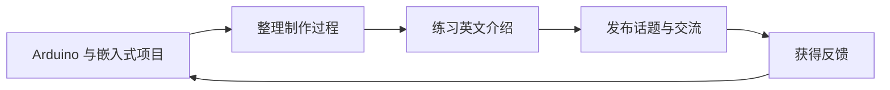

---
tags:
  - 个人网站
  - Arduino
  - 英语学习
status: 初步原型
---

# NEON / LAB：个人网站初步骨架

## 我的出发点

我正在学习嵌入式与 Arduino，也喜欢和英语母语者交流。这个网站是我的个人实验室：展示硬件项目，练习用英语介绍作品，并围绕共同兴趣认识别人。

今天的任务是确定设计骨架，并做出可预览的首页。暂定名称为 NEON / LAB，后面可以调整。

## 核心体验

**做项目 → 用英语讲项目 → 与人交流 → 得到反馈 → 改进项目。**

三个功能围绕同一个人的学习过程组织。项目提供真实话题，英语练习帮助表达，社交让作品得到交流机会。



## 页面骨架

```text
NEON / LAB
├─ 首页
│  ├─ 个人定位：Build. Speak. Connect.
│  ├─ 交互工作台：LED 闪烁示意
│  ├─ 项目实验室入口
│  ├─ 英文表达练习
│  └─ 交流话题入口
├─ 项目实验室
│  ├─ 项目筛选：Arduino / 嵌入式
│  └─ 项目详情：目标 / 器件 / 接线 / 代码 / 调试 / 英文介绍
├─ 英语频道
│  ├─ 围绕项目的双语例句
│  ├─ 常用技术词汇
│  └─ 我的英文介绍草稿
└─ 交流空间
   ├─ Show & Tell：展示作品
   ├─ Build Together：一起做项目
   └─ Language Exchange：语言交流
```

第一版以上入口集中在一个首页，项目详情先用弹窗展示骨架；后续内容丰富后拆成独立页面。

## 视觉方向

参考《赛博朋克 2077》的荧光黄、暗色工业界面与终端氛围，使用原创布局和图形。

| 元素 | 初步选择 | 用途 |
| --- | --- | --- |
| 页面底色 | `#101214` | 保持安静的阅读背景 |
| 主要强调色 | `#EFFF36` | 标题、重要按钮、项目亮点 |
| 辅助强调色 | `#6DE4E0` | 电路与英语频道 |
| 正文颜色 | `#EFF0E8` | 正文与标题 |
| 次要文字 | `#A6AAAD` | 描述、标签、说明 |
| 字体 | 中文无衬线＋英文等宽标签 | 内容清晰、保留终端感 |
| 形状 | 细边框、局部切角、网格 | 工业感与秩序 |
| 动效 | 可暂停的 LED 节奏 | 呼应 Arduino，不干扰阅读 |

避免大面积闪屏、过多霓虹光晕和难读的正文。适配手机，并尊重系统减少动画偏好。

## 功能阶段

### 当前原型

- [x] 首页与三个板块的视觉骨架。
- [x] 项目分类筛选与详情模板。
- [x] LED 页面动画调节。
- [x] 中英文例句切换。
- [x] 英文练习与话题的浏览器本地保存。
- [x] 话题草稿导出 Markdown，供 Obsidian 使用。

### 第一版上线前

- [ ] 换上自己的站名、介绍和真实项目。
- [ ] 提供至少一个完整 Arduino 项目及源码。
- [ ] 选定 GitHub 仓库并配置静态部署。
- [ ] 将实际发布文章与内部设计笔记分开管理。

### 后续真实社交

- [ ] 用户身份与个人资料：兴趣、学习语言、愿意提供的语言帮助。
- [ ] 项目评论和话题回复。
- [ ] 语言交流邀约，由双方决定是否接受。
- [ ] 私信、通知及举报／屏蔽机制。
- [ ] 必要时再增加语音与伙伴匹配。

初期优先围绕项目的公开交流。网站能提供连接入口，但不能保证自然吸引到英语母语者；还需要真实内容、邀请和社区运营。

## 技术选择

当前使用 HTML、CSS 和原生 JavaScript，无依赖，方便先看效果。草稿只保存在当前浏览器中。内容增加后可迁移到 Astro 与 Markdown；真实多人社交需另选后端和数据库。

GitHub 管理源码与公开笔记；Obsidian 打开本目录编辑设计记录。网站公开文章以后放在独立的内容目录，不自动将所有设计笔记展示在网页里。

## 我的下一步

先体验首页，回答三个问题：

1. 我喜欢这种黑灰、荧光黄与电光青的组合吗？
2. 我的第一个真实 Arduino 项目是什么？
3. 最先想开放的是作品评论，还是语言交流话题？

之后按 [[01-开发日志]] 记录每轮改动。
