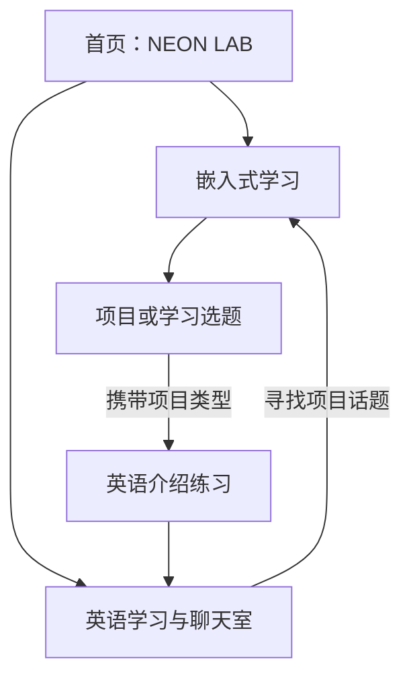

# 同一个实验室，两种空间

## 本轮决定

英语学习和嵌入式学习分成独立页面，通过导航、首页入口和项目内的按钮互相跳转。两页共享 NEON / LAB 的身份，但按照使用任务改变色彩、形状和布局。

| 维度 | 嵌入式学习 | 英语学习与聊天室 |
| --- | --- | --- |
| 地址 | `embedded.html` | `english.html` |
| 场景比喻 | 工程工作台 | 夜间交流休息室 |
| 色彩 | 青绿、石墨黑、荧光黄 | 暗紫、玫红、柔和粉色 |
| 形状 | 直角、细边框、切角按钮 | 圆角面板、对话气泡 |
| 排版 | 清晰分区、代码标签、实验清单 | 较柔和标题、短段落、对话节奏 |
| 布局 | 学习路径＋当前任务＋实验台＋项目 | 房间列表＋对话区＋表达提示 |
| 主要操作 | 选实验、记录完成情况、保存笔记 | 选话题、练习回复、整理英文介绍 |

## 保持协调的规则

- 同一个品牌标志、导航顺序、页面宽度与文字体系。
- 都采用深色基底，保留克制的霓虹强调色。
- 导航清楚标记当前页面，随时能够返回首页或另一频道。
- 首页保留女性创客氛围图，作为两个频道共享的世界背景。
- 内页将阅读与学习放在前面，避免大图挤占操作区域。

## 页面关系

## 本次交付

- 首页变为两个频道的入口。
- 嵌入式页有三类自主学习清单，完成情况按选题独立保存。
- 原 LED 动画工作台和项目筛选迁入嵌入式页。
- 实验笔记可以保存到当前浏览器或导出 Markdown。
- 英语页提供 Night Café、Maker Talk、Language Exchange 三个房间。
- 房间展示预设示例对话，用户输入加入本地练习记录；不会发送，也不会自动生成回复。
- 切换房间时保留本次未提交的输入；已加入的练习记录保存在浏览器中。
- 项目跳转到英语页时可以带入对应开场句；不覆盖已有练习草稿。

## 后续实现

先验证两页的风格与操作，再接入真实项目和课程内容。真人聊天室需要另行实现用户身份、服务器、消息存储与社区管理；当前不展示虚构的在线人数、真人身份或连接状态。

## 验证

已检查脚本语法、三个页面间的链接、锚点和静态资源引用。临时本地 HTTP 服务检查通过：首页、两个频道、样式、频道脚本和配图返回 200，未知地址返回 404；检查结束后服务已关闭。浏览器视觉与完整交互验收尚未完成。
