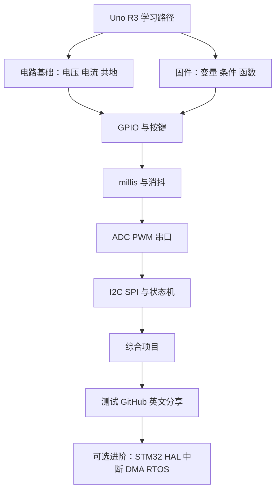

# Uno R3：8 周学习与项目实践

适用：用户确认的 Uno R3 或兼容板。建议每周 5 天、每天 45 分钟，可按进度调整。以下代码为教学示例，未进行 Arduino 工具链编译或硬件实测。

## 知识关系



## 每日节奏

10 分钟读原理 → 25 分钟做实验 → 10 分钟记录。每周依次做：预习、搭建、修改、排错、复盘。未达到验收标准时延长该周。

## 8 周计划

### 第 1 周：建立闭环

- 知识：认识 Uno R3、供电、GND；理解变量、条件和 setup/loop。
- 实践：上传 Heartbeat；改变间隔；记录现象。
- 验收：能解释 LED 每次翻转和完整周期的区别。

### 第 2 周：输入与消抖

- 知识：理解上拉、有效电平、边沿；用 millis 计时。
- 实践：制作 ButtonLamp；测试短按和长按。
- 验收：连续按 20 次，每次只切换一次；长按不连发。

### 第 3 周：模拟输入与 PWM

- 知识：理解 ADC 数值和 PWM 占空比的区别；PWM 不是可任意输出的模拟电压。
- 实践：先用电位器观察 ADC，再跟随官方 Fading 示例。
- 验收：旋钮改变时数据连续变化；能解释 LED 亮度变化。

### 第 4 周：串口与调试

- 知识：用日志区分接线错误和程序路径；匹配波特率。
- 实践：记录 ADC 的最小值、最大值与时间；故意制造一个可恢复错误。
- 验收：能用日志定位一个问题，并写下证据。

### 第 5 周：状态机与阈值

- 知识：学习采样周期、阈值、滞回和状态切换。
- 实践：完成 ThresholdMonitor；观察 550–650 中间区间。
- 验收：中间区间保持上一次状态，避免来回抖动。

### 第 6 周：模块通信

- 知识：先理解 I2C 地址、SDA/SCL、共地；再认识 SPI 的片选。
- 实践：选定具体模块后查数据手册，制作接线表并读取一个值。
- 验收：解释电源和逻辑电平；型号未确认前不直接照搬接线。

### 第 7 周：综合项目

- 知识：将输入、状态机、输出和日志拆成函数。
- 实践：把按键模式选择与阈值监测组合成桌面监测终端。
- 验收：连续运行 10 分钟、重复操作 20 次，记录问题与修复。

### 第 8 周：发布与复盘

- 知识：补全 README、器材表、接线、演示和版本记录。
- 实践：发布可复现的 GitHub 项目，写三句英文介绍。
- 验收：别人能按说明复现；能口头解释核心代码，而非仅复制。

## 项目实践

### 项目一：板载心跳灯

目标：用非阻塞计时控制板载 LED，每隔 500 ms 翻转一次，同时输出串口日志。

前置：变量、布尔值、条件判断；了解 setup 与 loop。

器材：Uno R3 或兼容板、支持数据传输的 USB 线、Arduino IDE。

| 元件 / 条件 | 连接 / 要求 |
| --- | --- |
| 板载 LED | LED_BUILTIN（Uno R3 对应 D13） |
| 电脑 | USB 连接开发板；无需外接元件 |

1. IDE 选择 Arduino Uno 与实际端口，打开下载的 Heartbeat.ino。
2. 上传后打开串口监视器，设为 9600。
3. 观察 ON/OFF，再将 intervalMs 改成 200，重新上传对比。

现象：500 ms 翻转一次，完整亮灭周期约 1 秒；200 ms 时周期约 0.4 秒。

验收：连续观察 10 个周期；说明为什么使用 now - previousMs；提交修改前后记录。

排错：无串口：确认数据线、端口和 9600；无灯：检查兼容板的板载 LED 定义。不要用重新插拔代替阅读报错。

英文介绍：I made the onboard LED blink without blocking the program.

```cpp
// Target: Arduino Uno R3 (ATmega328P). Uses onboard LED; no external wiring.
const unsigned long intervalMs = 500;
unsigned long previousMs = 0;
bool ledOn = false;
void setup() {
  pinMode(LED_BUILTIN, OUTPUT);
  Serial.begin(9600);
}
void loop() {
  const unsigned long now = millis();
  if (now - previousMs >= intervalMs) {
    previousMs = now;
    ledOn = !ledOn;
    digitalWrite(LED_BUILTIN, ledOn);
    Serial.println(ledOn ? "ON" : "OFF");
  }
}

```

### 项目二：按键切换灯

目标：每次按下只切换一次，长按不重复触发，并用 30 ms 软件消抖。

前置：先完成心跳灯；理解 INPUT_PULLUP 让松开为 HIGH、按下为 LOW。

器材：Uno R3、USB 线、常开按键、面包板、跳线。使用板载 LED。

| 元件 / 条件 | 连接 / 要求 |
| --- | --- |
| 按键一个触点 | D2 |
| 按键另一个触点 | GND |
| 四脚按键 | 先确认哪些脚内部常通，跨接两个独立触点；断电接线 |

1. 断开 USB，按接线表连接；无需外接上拉电阻。
2. 接回 USB，选择 Arduino Uno/端口并上传 ButtonLamp.ino。
3. 串口设 9600，分别短按、长按和快速连续按。

现象：每次有效按下 LED 翻转并打印一次；松开和长按不重复翻转。

验收：按 20 次，应翻转 20 次；长按 3 秒仅一次；更改消抖时间并记录差异。

排错：永远 LOW：检查是否接到了同一组常通脚；永远 HIGH：检查共地和按键触点；重复触发：查看原始读数和消抖状态。

英文介绍：The button toggles the light once per press, with software debouncing.

```cpp
// Target: Uno R3. Normally-open button between D2 and GND.
const byte buttonPin = 2;
bool lastRaw = HIGH, stable = HIGH, ledOn = false;
unsigned long changedAt = 0;
void setup() {
  pinMode(buttonPin, INPUT_PULLUP);
  pinMode(LED_BUILTIN, OUTPUT);
  Serial.begin(9600);
}
void loop() {
  const unsigned long now = millis();
  const bool raw = digitalRead(buttonPin);
  if (raw != lastRaw) { changedAt = now; lastRaw = raw; }
  if (now - changedAt >= 30 && raw != stable) {
    stable = raw;
    if (stable == LOW) {
      ledOn = !ledOn;
      digitalWrite(LED_BUILTIN, ledOn);
      Serial.println(ledOn ? "ON" : "OFF");
    }
  }
}

```

### 项目三：桌面阈值监测器

目标：用电位器模拟传感器，展示 ADC 数值并用滞回阈值控制板载灯。

前置：理解 analogRead、采样周期与布尔状态；先完成输入实验。

器材：Uno R3、10 kΩ 电位器、面包板、跳线、USB 线。

| 元件 / 条件 | 连接 / 要求 |
| --- | --- |
| 电位器外侧端 A | Uno 的 5V |
| 电位器外侧端 B | GND |
| 滑动端（确认器件引脚，常见为中脚） | A0 |
| 接线条件 | 仅适用于本例 Uno R3 的 0–5V ADC 输入；断电接线，勿将 5V 接 GND |

1. 确认电位器三个端子，再按表连接；本例仅 USB 供电。
2. 选择 Arduino Uno，上传 ThresholdMonitor.ino，串口设 9600。
3. 慢慢转动旋钮，先超过 650，再降到 550 以下，观察 CSV 日志。

现象：理想 ADC 范围约 0–1023；>=650 开灯、<=550 关灯，之间保持原状态。每 100 ms 输出一次。

验收：分别从低向高、高向低穿越中间区间；记录阈值与状态。连续运行 10 分钟，不把模拟输入称作真实温湿度数据。

排错：数值随机跳：检查滑动端接触和 GND；一直极值：核对端子；不能用本示例给 3.3V MCU 直接输入 5V。

英文介绍：I built a threshold monitor with hysteresis to prevent rapid switching.

```cpp
// Target: Uno R3. 10k potentiometer ends: 5V/GND, wiper: A0.
unsigned long sampledAt = 0;
bool alarmOn = false;
void setup() {
  pinMode(LED_BUILTIN, OUTPUT);
  Serial.begin(9600);
}
void loop() {
  const unsigned long now = millis();
  if (now - sampledAt < 100) return;
  sampledAt = now;
  const int value = analogRead(A0);
  if (value >= 650) alarmOn = true;
  else if (value <= 550) alarmOn = false;
  digitalWrite(LED_BUILTIN, alarmOn);
  Serial.print(value);
  Serial.print(',');
  Serial.println(alarmOn ? 1 : 0);
}

```

## 资料与进阶

[Uno R3 官方资料](https://docs.arduino.cc/hardware/uno-rev3) · [官方示例](https://docs.arduino.cc/built-in-examples/)

进阶：C 位操作和指针 → STM32 GPIO → 中断 → UART → 定时器 / ADC → I2C / SPI → DMA → RTOS。重新核对具体板型，不能混用 R3 与 STM32 的电压和引脚。
