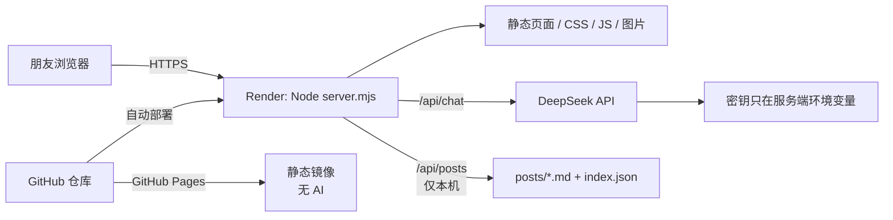
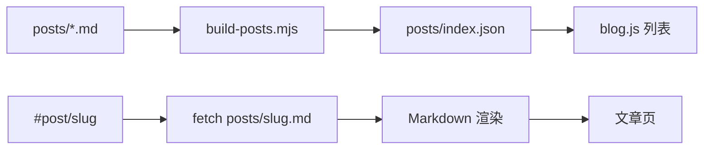

> [!abstract] 这篇日志是什么
> 它既是 NEON LAB 从 V0.2 到 V0.6 的开发记录，也是一份可以照着学的**前端 + Node 全栈入门材料**。  
> 读法建议：先看「项目一页纸」和「代码地图」，再按「前端学习路线」逐节读代码，最后做文末练习。

## 0. 在线地址

| 用途 | 地址 |
| --- | --- |
| 完整网站（含 AI） | <https://neon-lab.onrender.com> |
| GitHub 仓库 | <https://github.com/lfh2004106/neon-lab> |
| GitHub Pages 静态站（无 AI） | <https://lfh2004106.github.io/neon-lab/> |

> [!warning] 两个线上地址不是一回事
> Render 运行 Node 后端，所以 AI 对话和博客发布接口可用；GitHub Pages 只能托管静态文件，AI 不可用。  
> Render 免费实例会休眠，第一次打开可能需要等几十秒。

---

## 1. 项目一页纸

**NEON / LAB** 是一个面向 Arduino 与嵌入式学习者的个人网站，核心闭环：

```text
做项目 → 用英语讲项目 → 写成实验日志 → 得到反馈 → 改进项目
```

整个网站由四个页面组成：

| 页面 | 文件 | 作用 |
| --- | --- | --- |
| 首页 | `index.html` | 品牌、两个频道入口、实验日志入口 |
| 嵌入式学习 | `embedded.html` | 8 周 Uno R3 路线、知识导图、三个项目、学习进度、实验笔记 |
| 英语聊天室 | `english.html` | 三个话题房间、本地练习、AI 英语对话、英文表达练习 |
| 实验日志 | `blog.html` | Markdown 日志列表、阅读页、标签筛选、写日志表单 |

技术栈：

- 前端：原生 HTML、CSS、JavaScript，无框架、无构建步骤；
- 后端：Node.js 原生 `http` 模块；
- AI：DeepSeek Chat Completions（通过服务端代理）；
- 存储：浏览器 `localStorage` + 服务端 `posts/*.md`；
- 部署：GitHub + Render + GitHub Pages。

### 项目边界

这是个人学习站点，不是完整社交产品。没有真实注册、登录、评论、匹配和私信；示例角色会明确标注为示例，AI 会明确标注为 AI。项目卡片仍是选题模板，不是虚构的已完成作品。

---

## 2. 版本演进

| 版本 | 主要变化 | 学到的东西 |
| --- | --- | --- |
| V0.2 | After Hours 首页、女性创客配图、LED 动效 | 视觉叙事、图片裁切、伪元素遮罩 |
| V0.3 | 拆成嵌入式页和英语页 | 共享导航、两套主题、页面之间的参数传递 |
| V0.4 | 工业工作室、暖色沙龙、可配置 Chat Completions 后端 | Node 代理、密钥隔离、localStorage 草稿 |
| V0.5 | Uno R3 8 周课程、三个项目、学习进度、AI 对话 | 内容结构、课程设计、流式思考之外的会话状态 |
| V0.6 | 实验日志、氛围背景、移动端导航、Render 部署 | Markdown 渲染、XSS 防护、CORS、生产环境变量 |

时间线里最重要的一条：**每增加一个功能，都要同时想清楚它运行在哪一层**。  
静态页面、浏览器存储、Node 服务端、外部 AI API、部署平台，各自负责不同的事情。

---

## 3. 代码地图

```text
neon-lab/
├─ index.html                 首页
├─ embedded.html              嵌入式学习
├─ english.html               英语聊天室
├─ blog.html                  实验日志
├─ styles.css                 全局设计系统与布局
├─ atmosphere.css             首页 After Hours 氛围
├─ worlds.css                 两个频道的协调主题
├─ spaces.css                 工作室与沙龙场景
├─ learning.css               8 周课程与项目卡片
├─ ambient.css                V0.6 氛围背景、四阶段、日志入口
├─ blog.css                   日志页与文章排版
├─ app.js                     共用交互、草稿、项目弹窗
├─ studio.js                  学习清单、实验笔记
├─ learning.js                周验收进度
├─ lounge.js                  房间、本地练习、AI 对话
├─ blog.js                    Markdown 日志列表、阅读、写作
├─ server.mjs                 静态托管 + 路由
├─ chat-api.mjs               DeepSeek 代理、限额、CORS
├─ blog-api.mjs               仅本机可用的写日志接口
├─ scripts/
│  ├─ post-utils.mjs          frontmatter、slug、manifest
│  └─ build-posts.mjs         生成 posts/index.json
├─ posts/                     日志 Markdown + 索引
├─ assets/                    原创配图与压缩背景
├─ notes/                     Obsidian 设计笔记
├─ examples/                  三个 Arduino .ino
├─ tests/chat-api.test.mjs    模拟接口测试
├─ render.yaml                Render Blueprint
└─ DEPLOY.md                  部署与排错手册
```

### 推荐阅读顺序

1. `index.html` → `styles.css` → `atmosphere.css`
2. `embedded.html` → `worlds.css` → `spaces.css` → `learning.css`
3. `app.js` → `studio.js` → `learning.js`
4. `english.html` → `lounge.js`
5. `blog.html` → `blog.js` → `blog.css`
6. `server.mjs` → `chat-api.mjs` → `blog-api.mjs`
7. `scripts/post-utils.mjs` → `tests/chat-api.test.mjs`
8. `render.yaml` → `DEPLOY.md`

---

## 4. 系统架构



### 为什么要 GitHub + Render 两个平台

- **GitHub**：版本管理、公开源码、GitHub Pages 静态托管；
- **Render**：真正运行 Node 进程、保存密钥、代理 AI 请求；
- **GitHub Pages**：只能托管 HTML/CSS/JS，不能运行 `server.mjs`。

如果把 API Key 写进前端 JS，任何人打开开发者工具都能拿到；所以 AI 必须经过服务端代理。

---

## 5. 前端学习路线

| 阶段 | 学什么 | 在项目里看哪里 | 练习 |
| --- | --- | --- | --- |
| HTML | 语义标签、导航、表单、可访问性 | 四个 HTML 页面的 header/main/footer | 给博客加一个搜索框 |
| CSS 基础 | 变量、盒模型、选择器、层叠 | `styles.css` 的 `:root` 和 `.wrap` | 换一套主色 |
| CSS 布局 | Grid、Flex、`min()`、`clamp()` | `.portal-grid`、`.week-grid`、`.phase-grid` | 把四阶段改成两列 |
| 响应式 | 媒体查询、移动端优先 | `@media (max-width: 760px)` | 在 375px 宽度下检查溢出 |
| 视觉效果 | 渐变、伪元素、z-index、混合模式 | `ambient.css` | 换一张背景并调透明度 |
| JS 基础 | DOM、事件、可选链、数组方法 | `app.js`、`studio.js` | 给项目卡片加筛选动画 |
| 浏览器存储 | localStorage、JSON、异常处理 | `storage` 对象 | 存一个“最近访问”记录 |
| 网络请求 | fetch、async/await、超时、错误处理 | `lounge.js` | 给 AI 回复加“复制”按钮 |
| 路由 | hashchange、URL 状态 | `blog.js` | 给日志加“下一篇” |
| 安全 | 转义、URL 白名单、密钥隔离 | `blog.js`、`chat-api.mjs` | 尝试注入 `<script>` 看是否被转义 |
| Node | HTTP、路由、文件、环境变量 | `server.mjs` | 加一个 `/health` 接口 |
| 部署 | Git、环境变量、CORS、日志 | `DEPLOY.md` | 改一个环境变量并重新部署 |

---

## 6. HTML：语义结构与共享骨架

每个页面都有相同的开头：

```html
<a class="skip" href="#main">跳到主要内容</a>
<header class="header wrap">
  <a class="brand" href="./index.html">…</a>
  <nav aria-label="主导航">
    <a href="./index.html">首页</a>
    <a href="./embedded.html">嵌入式学习</a>
    <a href="./english.html">英语聊天室</a>
    <a href="./blog.html">实验日志</a>
  </nav>
</header>
<main id="main">…</main>
<footer class="wrap">…</footer>
```

学习点：

- **语义标签**：`header`、`nav`、`main`、`section`、`footer` 让结构可读，也方便辅助技术；
- **`aria-current="page"`**：告诉读屏器当前是哪一页；
- **`skip` 链接**：键盘用户可以跳过导航直达正文；
- **每个页面重复 header**：静态站点没有组件系统，所以导航要手动保持一致；
- **`defer` 脚本**：先下载，等 HTML 解析完再按顺序执行。

### 练习

1. 给 `blog.html` 的标签筛选加一个“清除筛选”按钮；
2. 检查四个页面的 `<h1>` 是否都只有一个；
3. 用键盘 Tab 走一遍，确认能到达每个按钮和输入框。

---

## 7. CSS：设计系统与布局

### 7.1 变量

`styles.css` 顶部定义全局变量：

```css
:root {
  color-scheme: dark;
  --bg: #101214;
  --panel: #191c20;
  --line: #34383c;
  --text: #eff0e8;
  --muted: #a6aaad;
  --yellow: #efff36;
  --cyan: #6de4e0;
  --mono: Consolas, "Courier New", monospace;
}
```

然后不同的页面主题覆盖它们：

```css
.world-embedded { --yellow: #dfd294; --cyan: #b2c7b0; }
.world-english  { --yellow: #efc48e; --cyan: #e9bd8e; }
```

这就是最简单的“设计 token”思想：颜色不散落在每个组件里，而是集中定义，换主题只改少数几行。

### 7.2 布局尺子

```css
.wrap {
  width: min(1240px, calc(100% - 96px));
  margin-inline: auto;
}
```

- `min()` 取更小的值：大屏最多 1240px，小屏自动留 48px 两侧边距；
- `margin-inline: auto` 水平居中；
- 所有页面共用同一把“尺子”，视觉更统一。

### 7.3 网格

```css
.phase-grid {
  display: grid;
  grid-template-columns: repeat(4, minmax(0, 1fr));
  gap: 14px;
}
```

- `minmax(0, 1fr)` 防止内容把列撑破；
- 移动端再改成 `1fr 1fr` 或单列；
- 卡片、项目、日志列表都使用同一套思路。

### 7.4 字号自适应

```css
.blog-hero h1 {
  font-size: clamp(52px, 6.4vw, 86px);
}
```

`clamp(最小值, 随视口变化, 最大值)` 比写很多断点更轻便。  
但中文标题要注意：字号太大时可能在手机上断成奇怪的两行，所以 V0.6 在移动端单独减小了字号。

### 练习

- 把 `--yellow` 改成你喜欢的颜色，观察四个页面如何一起变化；
- 把 `.phase-grid` 在桌面端改成两列，再在手机端改回一列；
- 给 `.wrap` 加一个 `max-width` 变量。

---

## 8. CSS：氛围背景与层叠

V0.6 的重点之一是“不要只是纯色块”。

### 8.1 固定背景层

`ambient.css` 用伪元素做全屏背景：

```css
body { position: relative; isolation: isolate; }

body::before,
body::after {
  content: "";
  position: fixed;
  inset: 0;
  z-index: 0;
  pointer-events: none;
}

body > header,
body > main,
body > footer {
  position: relative;
  z-index: 1;
}
```

嵌入式页再覆盖自己的背景：

```css
body.world-embedded::before {
  background:
    linear-gradient(180deg, #171c1dde 0%, #171c1df2 45%, #171c1d 100%),
    radial-gradient(ellipse 55% 50% at 88% 4%, #d7d69a1f, transparent 70%),
    url("./assets/engineering-studio-bg.jpg") center / cover no-repeat;
}
```

学习点：

- `position: fixed` 让背景不随页面滚动；
- 多层 `background` 从上层到下层叠加；
- 深色渐变覆盖照片，保证正文可读；
- 内容层用 `z-index: 1`，背景层用 `z-index: 0`，互不遮挡；
- `isolation: isolate` 创建独立层叠上下文，避免背景跑到页面外面；
- `pointer-events: none` 保证背景不挡住鼠标。

### 8.2 压缩背景图

原始配图是 2–3 MB 的 PNG，直接做 `background-image` 会让手机加载很慢。  
V0.6 用 Pillow 生成了约 120 KB 的 JPEG：

```text
assets/engineering-studio-v5.png  → engineering-studio-bg.jpg
assets/warm-salon-v4.png          → salon-bg.jpg
assets/industrial-studio-v4.png   → industrial-studio-bg.jpg
```

原图仍用于卡片和内容区，压缩图只做背景。  
**性能优化不是“把图删掉”，而是按用途选择尺寸和格式。**

### 8.3 背景网格

```css
body.world-embedded::after {
  background-image:
    linear-gradient(#cbd2a609 1px, transparent 1px),
    linear-gradient(90deg, #cbd2a609 1px, transparent 1px);
  background-size: 80px 80px;
  mask-image: linear-gradient(180deg, #000, transparent 92%);
}
```

`repeating-linear-gradient` 画网格，`mask-image` 让网格逐渐淡出，避免整页都是线。

### 练习

- 把嵌入式背景的渐变透明度调高/调低，观察可读性；
- 给英语页加一个暖色光斑；
- 把网格大小从 80px 改成 48px；
- 用 DevTools 的 Network 面板确认背景图大小。

---

## 9. 响应式：从桌面到手机

主要断点：

| 宽度 | 变化 |
| --- | --- |
| `max-width: 1050px` | 隐藏 edition、缩小标题、调整双栏 |
| `max-width: 760px` | 导航换行、单列布局、聊天区重排 |
| `max-width: 420px` | 四阶段单列、导航字号再缩小 |

移动端最容易出现的问题是**横向溢出**。排查方法：

```js
document.documentElement.scrollWidth > window.innerWidth
```

在 Chrome 里用设备模拟 390×844，检查：

- 长标题是否把容器撑宽；
- `width: 100%` 加 `padding` 是否超过父级；
- 按钮文字是否换行；
- 图片是否设置 `max-width: 100%`；
- 导航 4 个链接是否放得下。

V0.6 的博客标题在 390px 下曾把“故事”挤到第三行，后来把移动端字号从 `12vw` 降到 `9.5vw` 解决。

### 练习

在 390px 下打开四个页面，逐一检查：

1. 有没有横向滚动条；
2. 按钮能否点到；
3. 导航是否换行；
4. 聊天输入框是否被键盘遮住（可用真机测试）。

---

## 10. JavaScript：脚本如何组织

`embedded.html` 的加载顺序：

```html
<script src="./app.js" defer></script>
<script src="./studio.js" defer></script>
<script src="./learning.js" defer></script>
```

`defer` 保证：

- 不阻塞 HTML 解析；
- 按出现顺序执行；
- 执行时 DOM 已经可用。

`app.js` 定义了两个全局工具：

```js
const $ = (selector) => document.querySelector(selector);

const storage = {
  get(key) {
    try { return localStorage.getItem(`neon-lab:${key}`); }
    catch { return null; }
  },
  set(key, value) {
    try { localStorage.setItem(`neon-lab:${key}`, value); return true; }
    catch { return false; }
  }
};
```

后面的 `studio.js`、`learning.js`、`lounge.js` 直接使用 `$` 和 `storage`。

> [!warning] 这不是模块化
> 这种写法依赖脚本顺序和全局变量，适合小项目，但文件一多就会互相污染。  
> 更现代的做法是 ES Modules：
> ```html
> <script type="module" src="./app.js"></script>
> ```
> 然后用 `import`/`export` 明确依赖。

### 练习

- 把 `storage` 改成 ES Module，导出一个 `storage` 对象；
- 观察哪些文件需要加 `type="module"`；
- 注意：模块脚本默认也是延迟执行，但不能再用全局变量。

---

## 11. localStorage：把草稿留在浏览器

项目里的键都带前缀：

```text
neon-lab:intro
neon-lab:topic
neon-lab:lesson:blink
neon-lab:course-weeks
neon-lab:practice-log
```

保存学习进度：

```js
const saved = storage.set(
  `lesson:${activeLesson}`,
  JSON.stringify(checks)
);
```

读取时一定要防御坏数据：

```js
try {
  const value = JSON.parse(storage.get('practice-log') || '{}');
  if (saved && typeof saved === 'object') {
    /* 只接受合法结构 */
  }
} catch {
  /* 坏草稿不能拖垮整个页面 */
}
```

学习点：

- `try/catch`：隐私模式、存储空间满、用户禁用存储都可能抛异常；
- 长度限制：聊天练习只保留最近 50 条；
- 数据校验：`Array.isArray`、`typeof`、字段白名单；
- 不要把密钥、密码放进 localStorage。

### 练习

- 加一个“最近访问的页面”记录；
- 给实验笔记加自动保存（防抖 500ms）；
- 在隐私模式里测试保存失败提示。

---

## 12. DOM 与事件：聊天室如何切换

房间按钮使用事件委托：

```js
document.querySelectorAll('[data-room]').forEach(button => {
  button.addEventListener('click', () => {
    roomDrafts[currentRoom] = $('#chat-input').value;
    currentRoom = button.dataset.room;
    renderRoom();
  });
});
```

`renderRoom()` 负责整块 UI：

1. 更新标题、描述、开场句；
2. 清空消息区；
3. 根据“本地 / AI”模式渲染不同内容；
4. 恢复未发送的草稿；
5. 滚动到底部。

学习点：

- 用一个函数集中管理“状态 → 视图”，比散落修改 DOM 更可靠；
- 切换房间前保存当前输入，避免丢失；
- `textContent` 写用户输入，避免 HTML 注入；
- `addMessage()` 用 `document.createElement` 构造节点。

### 练习

- 增加一个“清空本地练习”按钮；
- 给房间按钮加上键盘方向键切换；
- 用 `Intl.DateTimeFormat` 显示消息时间。

---

## 13. AI 对话：浏览器到 DeepSeek

### 13.1 前端请求

```js
const response = await fetch('./api/chat', {
  method: 'POST',
  headers: { 'Content-Type': 'application/json' },
  body: JSON.stringify({ room, messages }),
  signal: AbortSignal.timeout(35000)
});
```

成功时：

```js
aiHistory[room] = [
  ...messages,
  { role: 'assistant', content: data.reply }
];
roomDrafts[room] = '';
renderRoom();
```

失败时：

```js
roomDrafts[room] = text;
renderRoom();
$('#chat-status').textContent = error.message + ' 你的输入已保留。';
```

学习点：

- `AbortSignal.timeout()` 防止请求永远挂着；
- 发送期间禁用按钮和输入框，避免重复提交；
- 失败保留草稿，这是“可用性”而不是装饰；
- 上下文按房间分开，刷新页面后清空；
- 前端只认识 `/api/chat`，不知道 DeepSeek 的密钥。

### 13.2 服务端代理

`chat-api.mjs` 的核心：

```js
const response = await fetch(settings.endpoint, {
  method: 'POST',
  signal: AbortSignal.timeout(30000),
  headers: {
    'Content-Type': 'application/json',
    Authorization: `Bearer ${settings.key}`
  },
  body: JSON.stringify({
    model: settings.model,
    stream: false,
    max_tokens: 500,
    ...(settings.deepseek ? { thinking: { type: 'disabled' } } : {}),
    messages: [systemPrompt, ...body.messages]
  })
});
```

安全点：

- Key 只从 `process.env` 读取；
- 请求体限制 48 KB；
- 消息数量、角色、长度全部校验；
- 每分钟/每小时请求数限制；
- 只允许同域或配置过的来源；
- 上游错误不把密钥或原始响应带回来。

> [!danger] 永远不要把 API Key 放进前端
> 浏览器里的任何“密钥”都不是秘密。正确结构是：浏览器 → 你的 Node 服务 → DeepSeek。

### 练习

- 把回复改成流式输出（SSE），观察前端如何逐字追加；
- 给 AI 加一个“重新生成”按钮；
- 在 `chat-api.mjs` 加一条“禁止系统提示注入”的测试。

---

## 14. 博客：从 Markdown 到页面

### 14.1 数据流



### 14.2 frontmatter

每篇文章开头：

```markdown
---
title: "第一次让 LED 心跳"
date: 2026-11-23
tags: [Arduino, GPIO, 实验日志]
summary: "用非阻塞计时让板载 LED 翻转。"
cover: "./assets/engineering-studio-bg.jpg"
---
```

`scripts/post-utils.mjs` 解析它，`build-posts.mjs` 生成 `index.json`：

```json
[
  {
    "slug": "2026-11-23-first-blink",
    "title": "第一次让 LED 心跳",
    "date": "2026-11-23",
    "tags": ["Arduino", "GPIO", "实验日志"],
    "summary": "…",
    "cover": "./assets/engineering-studio-bg.jpg"
  }
]
```

### 14.3 hash 路由

博客没有用 React Router，而是用 URL hash：

```text
blog.html              → 列表
blog.html#compose      → 写日志
blog.html#post/<slug>  → 文章
```

```js
function route() {
  const hash = decodeURIComponent(location.hash.replace(/^#/, ''));
  if (hash.startsWith('post/')) {
    openPost(hash.slice(5));
    return;
  }
  showList();
  if (hash === 'compose') {
    $('#compose').scrollIntoView({ behavior: 'smooth' });
  }
}

window.addEventListener('hashchange', route);
```

学习点：

- hash 变化不会刷新页面；
- 可以直接分享文章链接；
- 不需要服务器配置 history fallback；
- 缺点是 SEO 和复杂路由能力有限。

### 14.4 Markdown 渲染与 XSS

用户输入必须先转义：

```js
function escapeHtml(value) {
  return String(value)
    .replaceAll('&', '&amp;')
    .replaceAll('<', '&lt;')
    .replaceAll('>', '&gt;')
    .replaceAll('"', '&quot;')
    .replaceAll("'", '&#39;');
}
```

链接必须经过协议白名单：

```js
function safeUrl(value) {
  const url = String(value).trim();
  if (/^(https?:|mailto:|#)/i.test(url)) return url;
  if (/^[./\w-]/.test(url)) return url;
  return '#';
}
```

渲染器先提取代码块，再处理标题、列表、引用、表格，最后生成 HTML。  
**不能把原始 Markdown 直接塞进 `innerHTML`。**

### 14.5 写日志

本地运行 `node server.mjs` 时，表单会调用：

```js
await fetch('./api/posts', {
  method: 'POST',
  headers: { 'Content-Type': 'application/json' },
  body: JSON.stringify(post)
});
```

服务端 `blog-api.mjs`：

- 只允许本机回环地址；
- 只允许本地绑定（`HOST=127.0.0.1`）；
- 校验标题、摘要、正文长度；
- 生成唯一 slug；
- 写入 `posts/<slug>.md`；
- 重新生成 `posts/index.json`。

线上静态站不能写文件，所以按钮隐藏，改为“下载 Markdown → 提交 GitHub”。

### 练习

- 给文章加上一篇/下一篇；
- 给列表加搜索框；
- 给 Markdown 加图片灯箱；
- 给发布接口加一个简单口令（但不要用它替代真正的登录）。

---

## 15. Node 后端：两个接口

### 15.1 静态服务器

`server.mjs` 用白名单托管文件：

```js
const files = new Map([
  ['/', ['index.html', 'text/html; charset=utf-8']],
  ['/blog.html', ['blog.html', 'text/html; charset=utf-8']],
  // …
]);

const server = http.createServer(async (request, response) => {
  const pathname = decodeURIComponent(
    new URL(request.url, 'http://localhost').pathname
  );
  // /api/chat、/api/posts、/posts/* 分别处理
  const entry = files.get(pathname);
  // …
});
```

学习点：

- 手写服务器能帮你理解框架在做什么；
- 白名单避免路径穿越；
- `Cache-Control: no-store` 让开发时的修改立即生效；
- `HOST` 默认 `127.0.0.1`，部署时改为 `0.0.0.0`；
- `PORT` 由平台注入，不要写死。

### 15.2 AI 代理

`chat-api.mjs` 处理：

- `GET /api/status`：只返回 `{ configured: true/false }`；
- `POST /api/chat`：校验 → 限额 → 请求 DeepSeek → 返回文本；
- 统一 JSON 错误格式；
- 超时、上游 401/429、格式不兼容分别提示。

### 15.3 本机发布

`blog-api.mjs` 的安全边界：

```js
if (!isLocalBind() || !isLoopback(req)) {
  return json(res, 403, { error: '写日志接口只允许本机使用。' });
}
```

这保证 Render 上即使有人找到接口，也无法写入文件。

### 练习

- 加一个 `GET /api/health`，返回 `{ ok: true }`；
- 给 `/api/chat` 加一个 `X-Request-Id`，方便日志排查；
- 用 `curl` 测试 404、405、413、415、429。

---

## 16. 测试与验收

### 16.1 语法检查

```powershell
node --check app.js
node --check studio.js
node --check learning.js
node --check lounge.js
node --check blog.js
node --check server.mjs
node --check chat-api.mjs
node --check blog-api.mjs
```

### 16.2 接口测试

```powershell
node tests/chat-api.test.mjs
```

测试覆盖：

- 未配置密钥时的 503；
- 正常转发与 Authorization；
- 非法角色/空消息的 400；
- 跨站请求的 403；
- 上游 401 的 502；
- 错误信息不泄露密钥。

> [!note] 关于 `node --test`
> 在部分受限环境里，`node --test` 会因为无法创建子进程而报 `spawn EPERM`；  
> 这时直接运行测试文件即可：`node tests/chat-api.test.mjs`。这不是业务代码错误。

### 16.3 浏览器验收

我们用了两种方式：

1. 无头 Chrome 截图检查布局；
2. Chrome DevTools Protocol 驱动页面，检查：

```text
390×844 无横向溢出
四个页面导航正确
博客列表可加载
文章表格/代码块正常
AI 模式可切换
未配置时提示正确、输入保留
```

### 16.4 部署后验收

```powershell
curl.exe -I https://neon-lab.onrender.com/
curl.exe https://neon-lab.onrender.com/api/status
```

再实际发一条 AI 消息。  
**不要只看首页 200 就认为部署完成**，要检查 API、博客、静态资源和手机布局。

---

## 17. 部署复盘：这次踩过的坑

### 17.1 GitHub 仓库 vs 网站

一开始以为“有 GitHub 仓库，朋友就能打开网站”。实际上：

- 私有仓库：朋友连代码都看不到；
- 公开仓库：朋友能看代码，但看不到运行中的网站；
- GitHub Pages：能看静态页面，不能跑 Node；
- Render：能跑 Node，AI 才能工作。

### 17.2 下载错软件

下载了 GitHub Copilot（347 MB），不是 GitHub Desktop。  
最后没有继续折腾桌面版，而是用 GitHub CLI + Git：

```powershell
winget install Git.Git
winget install GitHub.cli
gh auth login --web
gh repo create neon-lab --private --source=. --push
```

设备码授权不需要把密码交给任何人。

### 17.3 密钥重复 `sk`

Render 部署后 AI 返回 401。原因是在环境变量里把已经带 `sk-` 的 Key 又手动加了 `sk`。  
修复后重新部署，AI 正常回复。

排查顺序：

1. `/api/status` 是否 `configured: true`；
2. `/api/chat` 是否 401/402/429；
3. Render 环境变量是否与本地 `.env` 完全一致；
4. 改完是否真的重新部署（看部署时间）。

### 17.4 卡片验证

Render 要求添加银行卡做身份验证，会临时授权 1 美元，不是消费；  
选择 Free 实例，不要误选付费方案。

### 17.5 免费实例休眠

Render Free 一段时间无访问会休眠，第一次打开慢是正常的。  
如果朋友较多，可以升级实例或换托管。

### 17.6 GitHub Pages 的边界

GitHub Pages 适合静态博客和课程页，不适合当前 Node AI 后端。  
把 API Key 写进 Pages 前端是错误做法。

---

## 18. 这次学到的 10 件事

1. **先分清运行层**：浏览器、Node、外部 API、静态托管，各自能做什么。
2. **密钥永远在服务端**；前端只能调用自己的接口。
3. **静态站点不是服务器**；`server.mjs` 不会因为文件上传 GitHub 就自动运行。
4. **XSS 防护从第一天做起**：转义文本、白名单 URL、不信任 Markdown。
5. **localStorage 要防御坏数据和存储失败**。
6. **响应式不是“缩小字体”**：要测真实宽度、长标题、按钮和导航。
7. **视觉效果要服务可读性**：背景图必须压暗、压缩、分层。
8. **部署后要验 API**，不能只看首页。
9. **文档和版本号要同步**：V0.3/V0.4/V0.5 混用会浪费排查时间。
10. **犯错日志比成功截图更有价值**：401、Copilot 下错、Pages 无 AI，都是学习材料。

---

## 19. 下一步练习清单

- [ ] 改一套主题色，跑一次 390px 宽度验收。
- [ ] 给博客列表加关键词搜索。
- [ ] 给日志加“上一篇 / 下一篇”。
- [ ] 给英语聊天室加第 4 个房间（同时改前端 `rooms` 和后端 `topics`）。
- [ ] 给 AI 回复加“复制”和“重新生成”。
- [ ] 把 AI 改成流式输出（SSE）。
- [ ] 给 `/api/posts` 写自动化测试。
- [ ] 加一个 `404.html`，并在 Render 里处理未知路由。
- [ ] 给部署加自定义域名。
- [ ] 把前端脚本改成 ES Modules，比较重构前后的依赖关系。

---

## 20. 文件与链接索引

| 内容 | 链接 |
| --- | --- |
| 首页 | <https://github.com/lfh2004106/neon-lab/blob/main/index.html> |
| 嵌入式页 | <https://github.com/lfh2004106/neon-lab/blob/main/embedded.html> |
| 英语页 | <https://github.com/lfh2004106/neon-lab/blob/main/english.html> |
| 博客页 | <https://github.com/lfh2004106/neon-lab/blob/main/blog.html> |
| 氛围样式 | <https://github.com/lfh2004106/neon-lab/blob/main/ambient.css> |
| AI 前端 | <https://github.com/lfh2004106/neon-lab/blob/main/lounge.js> |
| 博客前端 | <https://github.com/lfh2004106/neon-lab/blob/main/blog.js> |
| Node 服务器 | <https://github.com/lfh2004106/neon-lab/blob/main/server.mjs> |
| AI 代理 | <https://github.com/lfh2004106/neon-lab/blob/main/chat-api.mjs> |
| 部署手册 | <https://github.com/lfh2004106/neon-lab/blob/main/DEPLOY.md> |
| 设计笔记 | <https://github.com/lfh2004106/neon-lab/tree/main/notes> |

### 外部学习资料

- [MDN HTML](https://developer.mozilla.org/zh-CN/docs/Web/HTML)
- [MDN CSS](https://developer.mozilla.org/zh-CN/docs/Web/CSS)
- [MDN JavaScript](https://developer.mozilla.org/zh-CN/docs/Web/JavaScript)
- [web.dev 响应式设计](https://web.dev/learn/design/)
- [JavaScript.info](https://zh.javascript.info/)
- [Node.js 文档](https://nodejs.org/docs/latest-v22.x/api/)
- [DeepSeek API 文档](https://api-docs.deepseek.com/)
- [Render 文档](https://render.com/docs)

---

## 21. 复盘时间线

| 阶段 | 做了什么 | 最大的教训 |
| --- | --- | --- |
| 设计 | 确定“做项目 → 讲项目 → 记录 → 交流” | 功能围绕一个真实闭环，不为炫技 |
| 前端 | 四页、五套 CSS、原生 JS | 共享结构要一致，状态变化要集中渲染 |
| AI | DeepSeek 代理、上下文、限额 | 密钥隔离比功能更重要 |
| 博客 | Markdown、manifest、hash 路由 | 静态站也能有内容系统 |
| 部署 | GitHub、Pages、Render | 仓库不等于服务器 |
| 验收 | 语法、接口、浏览器、手机 | 只测首页 200 不算完成 |

> [!success] 当前状态
> 完整站点已上线，AI 已通过真实请求验证，GitHub Pages 提供静态镜像。  
> 下一步是把这里当练习场：每次改一个小功能，都走一遍「改代码 → 本地测试 → 手机检查 → 提交 → 部署」。

---

*日志版本：2026-11-23 · V0.6*
