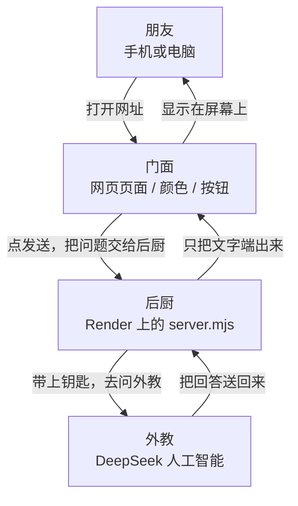
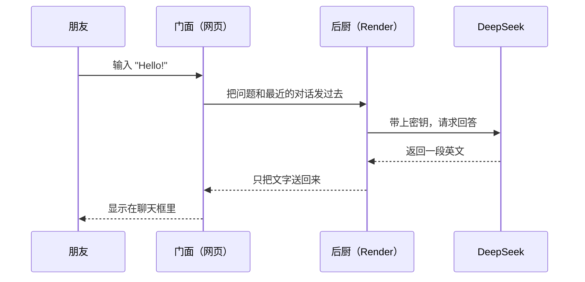
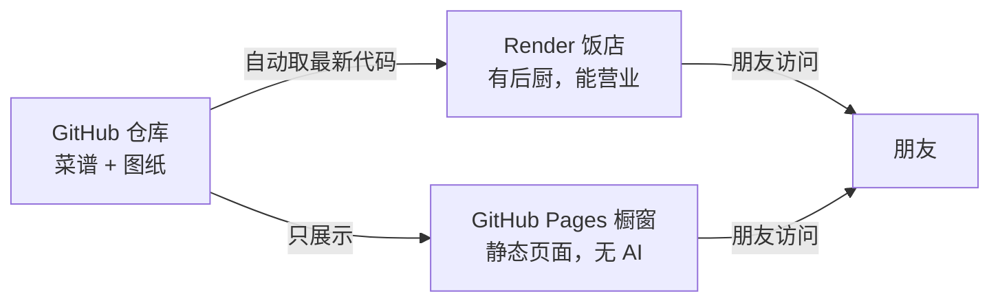
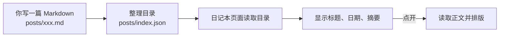

> [!abstract] 一句话
> 这是一个小网站：你可以在里面学单片机、练英语、写实验记录，还能让 AI 陪你用英语聊天。  
> 这篇是「姥姥版」，尽量不用专业词；想深入学代码，看 [[09-V0.6开发日志与前端学习]]。

## 0. 网址先放这儿

- 完整网站（能聊天）：<https://neon-lab.onrender.com>
- 代码仓库：<https://github.com/lfh2004106/neon-lab>
- 只看页面的地址：<https://lfh2004106.github.io/neon-lab/>

---

## 1. 先把四个词说明白

| 专业词 | 姥姥版解释 | 在这个网站里是谁 |
| --- | --- | --- |
| 前端 | 店面的门脸：招牌、灯光、桌椅、菜单 | 网页上的标题、颜色、按钮、聊天框 |
| 后端 | 后厨：客人看不见，但真正做事的地方 | Render 上运行的程序 |
| 数据库 | 档案柜：把东西存起来，下次还能找到 | 浏览器的 `localStorage`、`posts/` 里的文章 |
| 部署 | 把店开到大街上，让别人能走进来 | 把网站放到 Render，得到一个网址 |

再补充三个词：

- **GitHub**：放图纸和存档的仓库，不是营业中的饭店；
- **Render**：真正把饭店开起来、有人做饭的地方；
- **API 密钥**：后厨的钥匙，能点菜、能花钱，不能贴在门口。

---

## 2. 这个网站有什么

把它想成一个小院子，里面有四间房：

| 房间 | 叫什么 | 进去能干什么 |
| --- | --- | --- |
| 大门 | 首页 | 看介绍，选择去学硬件还是练英语 |
| 工作间 | 嵌入式学习 | 看 8 周学习路线、做三个小实验、记录进度 |
| 会客厅 | 英语聊天室 | 选话题，先用本地例句练，再和 AI 对话 |
| 日记本 | 实验日志 | 看你写的实验记录，也可以自己写一篇 |

---

## 3. 一张图看懂：谁在干活

先看文字版，最直白：

```text
朋友打开网址
     ↓
【门面】网页：标题、图片、按钮、聊天框
     ↓ 点“发送”
【后厨】Render 上运行的程序
     ↓ 拿着钥匙去请教
【外教】DeepSeek 人工智能
     ↓ 把回答送回来
【后厨】再端给门面
     ↓
朋友看到文字
```

再画成方块图：



姥姥可以这样理解：

> 朋友只看见门面；真正去请外教的是后厨；钥匙一直在后厨，不在客人手里。

---

## 4. 网站的房子是怎么分的

### 4.1 门面：四个页面

```text
neon-lab/
├── index.html       大门
├── embedded.html    工作间
├── english.html     会客厅
└── blog.html        日记本
```

每个页面都穿同样的“外套”（导航、品牌、页脚），但里面的装修不同：

- 工作间是绿色、工业风，像小工作室；
- 会客厅是暖黄色，像晚上的茶馆；
- 日记本是米色纸张的感觉，像一本记录册。

### 4.2 装修：CSS

CSS 就是“油漆、灯光、家具摆放”。

```text
styles.css       总规则：颜色、字体、宽度
atmosphere.css   首页的电影感
worlds.css       两个房间各自的气质
spaces.css       工作室和沙龙的细节
learning.css     课程卡片的摆放
ambient.css      背景照片、网格、光晕
blog.css         日记本的排版
```

### 4.3 开关和动作：JavaScript

JavaScript 是“按了按钮以后发生什么”。

```text
app.js        共用的小工具：保存草稿、项目弹窗
studio.js     学习清单、实验笔记
learning.js   8 周进度打勾
lounge.js     聊天室切换、发消息、AI 对话
blog.js       日记列表、阅读文章、写新日志
```

### 4.4 后厨：Node 程序

```text
server.mjs     开门营业：把页面和文件递给浏览器
chat-api.mjs   帮你去找 DeepSeek，钥匙藏在这里
blog-api.mjs   只有在本机时，才允许把新日志写进文件夹
```

### 4.5 仓库和内容

```text
posts/      你写的实验日志（Markdown 文件）
notes/      学习笔记和设计记录
examples/   三个 Arduino 小项目的代码
assets/     图片
```

### 4.6 开店的说明书

```text
render.yaml  告诉 Render 怎么开店
DEPLOY.md    一步一步的部署说明
```

---

## 5. 朋友用 AI 聊天的完整过程

朋友看到的只有三步：

1. 打开网址；
2. 选择「AI 对话」；
3. 输入一句英语，点发送。

背后其实发生了这些事：



为什么不能直接让网页去问 DeepSeek？

因为那样就必须把钥匙交给网页，而网页是所有人都能打开看的。  
正确做法是：**网页只敲门，后厨拿钥匙去办事。**

---

## 6. GitHub、GitHub Pages、Render 到底谁管什么

用开饭店打比方：

| 东西 | 比喻 | 能做什么 | 不能做什么 |
| --- | --- | --- | --- |
| GitHub 仓库 | 放菜谱和装修图纸的档案柜 | 存代码、看历史、给别人看图纸 | 不会自己营业 |
| GitHub Pages | 橱窗里的照片 | 展示静态页面、博客 | 不能开火做饭（不能跑 AI 后端） |
| Render | 真正营业的饭店 | 运行 Node 程序、调用 AI、处理博客 | 免费店会打烊休息（休眠） |

所以：

- 只看页面：GitHub Pages 够；
- 要 AI 聊天：必须有 Render 这样的“后厨”；
- 代码仍然放 GitHub，Render 从 GitHub 取货。



---

## 7. 实验日志是怎么写进去的

### 7.1 日志长什么样

一篇日志就是一个普通的文本文件，开头写清楚：

```text
标题：第一次让 LED 心跳
日期：2026-11-23
标签：Arduino、实验日志
摘要：一句话说明这篇写了什么
```

下面才是正文，可以放代码、表格和图片。

### 7.2 它在网站里怎么出现



### 7.3 为什么线上不能直接写

GitHub Pages 和 Render 的网站代码是“展示用的”，不是给你在网页里随便改文件的。  
所以：

- 在本机运行 `node server.mjs` 时，可以点「发布到本地」，程序会把文件写进 `posts/`；
- 线上静态站没有写文件权限，只能「下载 Markdown」，再提交到 GitHub。

---

## 8. 这次遇到的三个小麻烦

### 8.1 下载错了软件

本来想装 GitHub 桌面版，结果下载成了 GitHub Copilot。

> 就像想买一个文件柜，结果买了一个会聊天的台灯。

后来没用桌面版，改用两个小工具（Git 和 GitHub CLI），让程序帮忙把代码送进仓库。

### 8.2 AI 不认钥匙

第一次上线，AI 说“认证失败”。原因是钥匙本来就叫 `sk-...`，又在前面多加了一个 `sk`。

> 就像身份证号已经写好了，又在前面抄了一遍，保安当然不认。

去掉重复的 `sk`，重新部署，AI 就正常说话了。

### 8.3 Render 要银行卡

它要确认“你是真人”，会临时冻结 1 美元，不是扣钱。  
就像住酒店先刷一笔押金，退房会还。

---

## 9. 姥姥可能会问的问题

### “网站会不会把我的钥匙弄丢？”

不会。钥匙只放在两个地方：

- 你电脑里的 `.env` 文件；
- Render 的环境变量。

GitHub 上的代码里没有钥匙。我检查过，朋友打不开 `.env`。

### “朋友能不能改我的网站？”

不能。线上写日志的接口只允许本机使用；跨站请求会被拒绝。

### “为什么朋友第一次打开很慢？”

Render 的免费店没人来时会在后厨休息，有人敲门才起来开门，所以要等几十秒。有人访问过后就会快一些。

### “为什么手机上看起来不一样？”

网页会“看屏幕大小换衣服”：电脑上两列，手机上改成一列，按钮变大，导航换行。这个叫响应式设计。

### “你的笔记会不会被别人看到？”

仓库现在是公开的，所以 `notes/` 里的学习笔记也会被看到。  
如果不想公开，可以把仓库改回私有，但 GitHub Pages 会停止。

---

## 10. 想学做网站，先学这四样

| 顺序 | 学什么 | 用做饭打比方 | 在这个项目里看 |
| --- | --- | --- | --- |
| 1 | HTML | 摆桌子、放菜单 | 四个 `.html` 文件 |
| 2 | CSS | 刷墙、打灯、摆花 | `.css` 文件 |
| 3 | JavaScript | 开关、按钮、端菜 | `.js` 文件 |
| 4 | Node / 部署 | 开饭店、办执照 | `server.mjs`、Render |

先别急着学框架。这个网站没有用 React，也没有用数据库，照样能上线。  
**先把“页面—按钮—数据—服务器”这条线走通，再学更复杂的工具。**

---

## 11. 三句话记住整个项目

1. **网页是门面，Render 是后厨，DeepSeek 是外请的老师。**
2. **GitHub 存图纸，Render 把店开起来，GitHub Pages 只是橱窗。**
3. **钥匙只放后厨，朋友只看门面。**

---

## 12. 上线检查清单（姥姥也能照着念）

- [ ] 首页能打开
- [ ] 四张图片能看见
- [ ] 手机上没有左右乱跑
- [ ] 英语页能切到 AI
- [ ] AI 能回一句英文
- [ ] 日志能点开
- [ ] 朋友打开的是 Render 网址，不是 GitHub 网页
- [ ] 钥匙没有出现在 GitHub 上

全部打勾，就可以把网址发给朋友了：

**<https://neon-lab.onrender.com>**

---

*这是 [[09-V0.6开发日志与前端学习]] 的通俗版；两边可以对照着看。*
