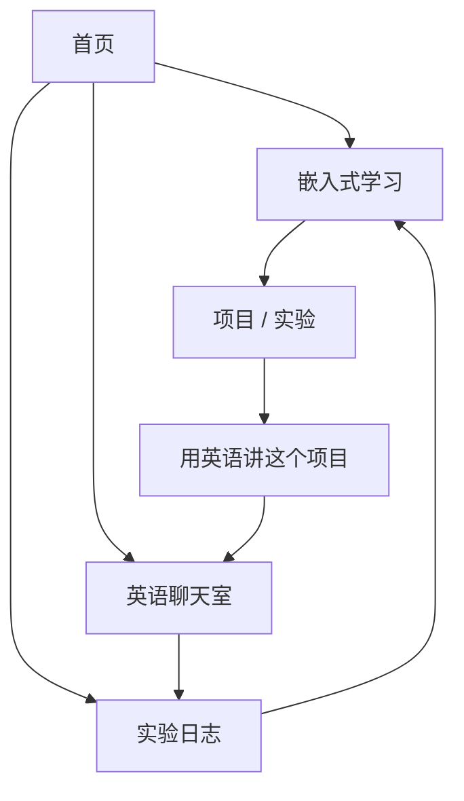

> [!abstract] 一句话
> 这不是一个“展示我会做网站”的作品集，而是一个**正在学习硬件、练习表达、持续做实验的人**的公开工作台。  
> 设计目标不是更花哨，而是让人 5 秒内看懂：你是谁、你在做什么、下一步看哪里。

## 1. 先找问题

现在的页面已经有氛围，但还有四个不够清楚的地方：

1. **首页视觉很强，内容还像模板**  
   人物图、标题、两个入口都很好，但“项目”仍是选题模板，朋友看不出你真正做了什么。

2. **嵌入式页信息太长**  
   8 周计划、三个项目、知识导图、实验台、项目列表、笔记全部堆在一页，手机约 8000px。  
   第一次来的人不知道“今天该看哪一段”。

3. **英语页的 AI 入口不够像主角**  
   页面好看，但 AI 只是下拉框里的一个选项；第一次来的人容易以为这里只有示例对话。

4. **博客没有完全接进学习闭环**  
   博客是好东西，但它现在像一个独立栏目，而不是“做完实验自然要写一页”的下一步。

设计不是换颜色，而是**安排注意力**。下面的方案都围绕这一点。

---

## 2. 设计定位

### 2.1 目标受众

- 和你一样的嵌入式初学者；
- 愿意交流的英语学习者/英语母语者；
- 未来可能给你机会的人：同学、老师、开源伙伴、面试官。

### 2.2 一条主线

```text
做项目 → 用英语讲清楚 → 写成实验日志 → 得到反馈 → 改进项目
```

网站上的每个页面都应该能放回这条线：

| 页面 | 在这条线里的位置 |
| --- | --- |
| 首页 | 告诉别人“我正在做这条线” |
| 嵌入式 | 做项目、记录证据 |
| 英语 | 把项目讲清楚 |
| 日志 | 把过程留下来 |

### 2.3 三个关键词

| 关键词 | 含义 | 不是什么 |
| --- | --- | --- |
| **真实** | 实物照片、串口数据、失败记录、真实代码 | 不是漂亮的空壳 |
| **清楚** | 先给结论，再给细节；一条路径走到底 | 不是信息越多越好 |
| **温度** | 女性的、夜晚的、有人情味的 | 不是冷冰冰的极客展示 |

---

## 3. 核心概念：一个实验室，两种光线

你已经有的品牌资产是 **ONE LAB / TWO WORLDS**。不要推翻它，建议把它做得更明确：

> **白天在工作室做实验，晚上在沙龙里把实验讲出来。**

```text
            同一个 NEON LAB
                    │
      ┌─────────────┴─────────────┐
      │                           │
  冷光 · 工作间               暖光 · 沙龙
  石墨灰 / 橄榄绿 / 台灯       深棕 / 琥珀 / 玫红
  示波器 / 面包板 / 图纸       茶桌 / 对话 / 英语
      │                           │
      └─────────────┬─────────────┘
                    │
             纸张 · 实验日志
             米白 / 墨色 / 印章
```

三个空间，共用一套骨架：

- 同样的导航和宽度；
- 同样的无衬线正文 + 等宽标签；
- 不同的主色、光线、图片和圆角；
- 日志页作为“纸张”，把两个世界连接起来。

### 为什么这个方向适合你

- 你已经有人物图、工作室图和沙龙图，不需要重新生成一堆图；
- 它把你的两个学习目标（硬件 + 英语）讲成了一个故事，而不是两个硬拼的栏目；
- “白天/夜晚”天然解释了为什么两个页面风格不同，又为什么仍然是一个网站。

---

## 4. 信息架构



导航只保留四个入口，不要继续加一级页面。  
如果要加东西，优先加到这四个页面内部的“区块”，而不是再造一个栏目。

---

## 5. 首页：5 秒内说明白

### 5.1 现在的优点

- 人物图有氛围，标题有记忆点；
- 两个入口清楚；
- 不是常见的“简历式作品集”。

### 5.2 需要改的地方

把“氛围”变成“信息 + 氛围”：

```text
┌──────────────────────────────────────────────┐
│ 品牌       首页  嵌入式  英语  日志      V0.6 │
├──────────────────────────────────────────────┤
│                                              │
│  BUILD.                                      │
│  SPEAK.           [人物/工作台图片]          │
│  CONNECT.                                     │
│                                              │
│  我在学 Arduino，也在练习用英语讲清楚它。     │
│  [看我的实验]  [读最新日志]                  │
│                                              │
│  NOW · 本周在做什么：按键消抖 / 第 2 周      │
└──────────────────────────────────────────────┘
        ↓
┌───────────────┬───────────────┐
│ 工作间         │ 沙龙           │
│ 课程 + 实验    │ AI + 口语      │
└───────────────┴───────────────┘
        ↓
┌──────────────────────────────────────────────┐
│ 精选项目：一个真实项目的大卡片               │
│ 目标 / 实物照片 / 关键数据 / 阅读完整记录    │
└──────────────────────────────────────────────┘
        ↓
┌──────────────────────────────────────────────┐
│ 最新实验日志（3 篇）                          │
└──────────────────────────────────────────────┘
```

### 5.3 首页必须回答的四个问题

1. 你是谁？——一句话，不要写“热爱科技”。
2. 你现在在做什么？——一个具体的项目/周次。
3. 我能看什么？——项目、日志、英语对话。
4. 下一步点哪里？——最多两个主要按钮。

### 5.4 删掉或弱化

- 空泛的“探索无限可能”；
- 没有真实内容支撑的项目卡片；
- 太多同级按钮；
- 一屏里三种不同的强调色。

---

## 6. 嵌入式页：从“课程表”变成“工作台”

### 6.1 现在的问题

信息很全，但第一次来的人会被 8 周计划淹没。  
建议把页面分成三层，而不是一条长龙：

```text
┌──────────────────────────────────────────────┐
│ 本周仪表盘                                    │
│ 第 2 周 / 输入与消抖                          │
│ 下一步：完成 ButtonLamp 的 20 次按键测试      │
│ 进度：███░░░░░ 2/8                            │
│ [继续实验]  [写实验日志]                      │
└──────────────────────────────────────────────┘

┌──────────────────────────────────────────────┐
│ 四阶段路线：闭环 → 感知 → 连接 → 交付          │
└──────────────────────────────────────────────┘

┌──────────────────┬───────────────────────────┐
│ 实验阶梯          │ 当前实验详情               │
│ 01 心跳灯  ✓      │ 目标 / 器材 / 接线         │
│ 02 按键灯  ●      │ 步骤 / 代码 / 现象         │
│ 03 阈值器  ○      │ 验收 / 排错 / 日志         │
└──────────────────┴───────────────────────────┘
```

### 6.2 三个具体改动

1. **加一个“本周仪表盘”**  
   放在最上面，告诉用户现在第几周、下一步做什么、完成多少。  
   这是从“课程目录”变成“学习状态”的关键。

2. **把 8 周计划折叠起来**  
   默认只显示当前周和下一周，其他周折叠。想要完整计划的人再展开。  
   页面长度可以从 8000px 降到 3000px 左右。

3. **每个实验用“证据卡”**  
   不要只有文字和代码。每个实验至少放：

   - 一张实物/接线照片；
   - 一段串口输出；
   - 一个关键数据（周期、读数、阈值）；
   - 一句“我遇到的最大问题”。

### 6.3 学习内容的结构

每个实验固定成同一套字段：

```text
目标 → 前置知识 → 器材 → 接线 → 代码 → 可观察现象
→ 验收标准 → 常见错误 → 我的记录 → 英文一句话
```

这样你写新实验时不会漏，读者也能快速对比。

---

## 7. 英语页：聊天是主角

### 7.1 现在的优点

- 暖色、沙龙、茶杯，氛围是对的；
- 三个房间有明确主题；
- AI 对话和本地练习有区分。

### 7.2 建议调整

```text
┌──────────────────────────────────────────────┐
│ 房间： Night Café / Maker Talk / Exchange     │
├───────────────┬──────────────────────────────┤
│ 小引导卡       │ 对话区（最大）               │
│ 今天的话题     │ AI / 本地切换                │
│ 主持人小头像   │ 消息气泡 + 输入框            │
│ 提示句         │                              │
└───────────────┴──────────────────────────────┘
```

- **对话区占 65% 以上**，不要被侧栏挤压；
- AI 模式要更明显：切换后显示“AI 已就绪 / 未配置”；
- 主持人头像缩小，放在引导卡里，不要让大图抢走聊天注意力；
- 移动端把侧栏折叠成“话题/提示”两个抽屉；
- 空状态给一句可直接发送的开场，不要只显示空白。

### 7.3 对话的视觉状态

| 状态 | 视觉 |
| --- | --- |
| 未配置 | 灰色提示 + “如何配置” |
| 等待 | 输入框禁用，气泡显示“正在组织语言…” |
| 成功 | 新气泡淡入，滚动到底 |
| 失败 | 保留输入，提示可重试，不伪造回复 |

---

## 8. 实验日志：把它做成“实验记录纸”

### 8.1 定位

日志不是“博客文章”，而是**实验档案**。  
它应该有纸张感，而不是第三个霓虹页面。

### 8.2 列表页

```text
[标签筛选：全部 / GPIO / 传感器 / 调试 / 英语]

┌──────────────────────────────────────────────┐
│ 2026.11.23  ·  GPIO  ·  2 min read           │
│ 第一次让 LED 心跳：从 delay 到 millis        │
│ 摘要……                                       │
│ [阅读全文]                                   │
└──────────────────────────────────────────────┘
```

### 8.3 文章模板

```text
实验编号 / 日期 / 项目 / 标签
一句话结论
────────────────────────
1. 今天的目标
2. 器材与接线
3. 代码或关键片段
4. 观察到什么（数据/照片）
5. 遇到的问题
6. 怎么排查
7. 下一步
8. 英文一句话
```

> 模板不是为了限制你，而是让你在累的时候也能写出可复盘的记录。

---

## 9. 视觉系统

### 9.1 颜色

不要再用更多的荧光色。每个空间只保留一个主强调色：

| 空间 | 底色 | 主色 | 辅助色 |
| --- | --- | --- | --- |
| 工作间 | `#171c1d` | 橄榄绿 `#b2c7b0` | 台灯黄 `#dfd294` |
| 沙龙 | `#211b18` | 琥珀 `#e9bd8e` | 玫红 `#e995ba` |
| 日志 | `#111410` | 米金 `#e8dc9b` | 纸白 `#f2edde` |

规则：

- 正文用中性色，不要用强调色写长段落；
- 强调色只给按钮、当前状态、关键数字；
- 图片上压深色渐变，保证文字可读；
- 三种空间共用 `--line`、`--muted` 等基础 token。

### 9.2 字体

- 中文正文：系统无衬线（微软雅黑/PingFang）；
- 英文标签/数字：等宽字体（Consolas / IBM Plex Mono）；
- 日志标题：衬线字体（Georgia / Songti），制造“纸张/编辑”感；
- 不要超过三种字体家族。

### 9.3 间距和网格

- 统一 8px 间距节奏：8 / 16 / 24 / 32 / 48；
- 桌面 12 栏，内容最大宽度 1240px；
- 手机 4 栏，左右至少 20px；
- 卡片内边距桌面 24px，手机 18px。

### 9.4 形状

- 工作间：直角、细边框、切角、仪表盘；
- 沙龙：圆角、软阴影、暖色气泡；
- 日志：纸张边框、胶带/印章/编号。

### 9.5 背景

继续用现在的照片背景，但控制强度：

- 图片压暗 80–90%，只留轮廓；
- 叠加 3–6% 的网格/噪点；
- 背景固定，内容滚动；
- 原始 PNG 做内容图，压缩 JPEG 做背景。

---

## 10. 动效：只留三个

1. **LED 心跳**：首页或工作台的小光点，慢节奏；
2. **内容浮现**：卡片进入视口时轻微上移，150–250ms；
3. **聊天打字状态**：三个点或一条细线，不要整页动画。

不要：

- 自动播放音乐；
- 鼠标跟随的 3D 光晕；
- 滚动劫持；
- 每个区块都做飞入。

尊重 `prefers-reduced-motion`，关闭后不影响使用。

---

## 11. 内容设计：让“证据”代替形容词

### 11.1 项目卡片字段

```text
项目名
一句话：它解决了什么
状态：进行中 / 已完成
证据：照片、串口截图、关键数据
技术：Arduino / C++ / 传感器
链接：代码 / 实验日志
```

### 11.2 “现在”区块

首页和嵌入式页都可以有一个 NOW：

```text
NOW · 2026.11.23
本周：按键消抖
正在读：Uno R3 数据手册
卡在：长按误触发
下一步：完成 20 次按键测试
```

这比“热爱学习”有说服力，也让网站有生命。

### 11.3 真实感

- 放真实的桌面照片，不一定要摆拍；
- 放失败的串口日志；
- 写出“这个方案不行”；
- 中文为主，关键术语给英文；
- 英文介绍短而自然，不要机翻长文。

---

## 12. 可访问性与性能

- 正文对比度至少 4.5:1；
- 所有按钮有键盘焦点样式；
- 链接文字不要只写“点击这里”；
- 图片有 alt，纯装饰图 `alt=""`；
- 手机点击区域至少 44px；
- 背景图压缩，首屏图片不要超过 300KB；
- 不依赖 hover 才能完成关键操作；
- AI 不可用时，页面仍然可以阅读和练习。

---

## 13. 实施顺序

### 第 1 步：统一骨架（1–2 天）

- 四个页面共用一套颜色、间距、按钮和导航；
- 首页加入 NOW 区块；
- 统一版本号和页脚；
- 手机 390px 检查横向溢出。

### 第 2 步：把内容变真实（3–5 天）

- 选一个真实项目，做成第一张“证据卡”；
- 写 2 篇完整实验日志；
- 嵌入式页加“本周仪表盘”，8 周计划默认折叠；
- 英语页把 AI 状态放到显眼位置。

### 第 3 步：打磨（2–3 天）

- 博客文章模板固定；
- 动效只保留三处；
- 检查性能、键盘和手机；
- 更新 README 和截图。

---

## 14. 参考网站怎么用

| 网站 | 借什么 | 不要借什么 |
| --- | --- | --- |
| [Julia Evans](https://jvns.ca/) | 亲切的技术解释、实验记录 | 手绘风格不必照搬 |
| [Bunnie Huang](https://www.bunniestudios.com/) | 硬件项目的完整叙事和照片 | 超长文章对新手太重 |
| [Maggie Appleton](https://maggieappleton.com/) | 笔记/文章/插图一起生长的结构 | 复杂的数字花园系统 |
| [Brittany Chiang](https://brittanychiang.com/) | 首屏定位、项目卡片 | 纯简历式、缺少过程 |
| [Josh Comeau](https://www.joshwcomeau.com/) | 教学型文章的节奏 | 大量交互会拖慢手机 |
| [阮一峰](https://www.ruanyifeng.com/blog/) | 长期更新、文字优先 | 不需要模仿旧式排版 |

---

## 15. 三个不要

1. **不要让 AI 配图比真实作品更抢眼。**  
   人物图是气氛，不是证据。

2. **不要为了“赛博朋克”加更多颜色和动画。**  
   一个页面一个主色，已经足够有记忆点。

3. **不要在内容还空的时候做社交功能。**  
   先有真实项目、真实日志，再考虑评论和匹配。

---

## 16. 验收清单

- [ ] 陌生人 5 秒内能说出“这个人在学嵌入式，也在练英语”。
- [ ] 首页有一个真实项目，不是模板。
- [ ] 嵌入式页第一屏能看到“本周 + 下一步”。
- [ ] 英语页第一眼能看出 AI 在哪里。
- [ ] 日志列表能按标签筛选，文章能直接分享。
- [ ] 手机 390px 没有横向滚动。
- [ ] 关闭动画后页面仍然完整可用。
- [ ] 背景图单张小于 300KB。
- [ ] 朋友打开 Render 链接能完成一次 AI 对话。

---

## 17. 我建议你先做的三件事

1. 把首页的“项目模板”换成**一个真实的 LED/按键项目**，放照片、代码和串口输出；
2. 给嵌入式页顶部加一个**本周仪表盘**，把 8 周计划默认折叠；
3. 把博客的第一篇文章写成**完整实验记录**，然后用它反推项目卡片要哪些字段。

这三件事做完，网站就会从“好看的原型”变成“有证据的个人站点”。

---

*这是设计提案，不是最终视觉稿；下一步可以直接做成首页和嵌入式页的线框/高保真稿。*
