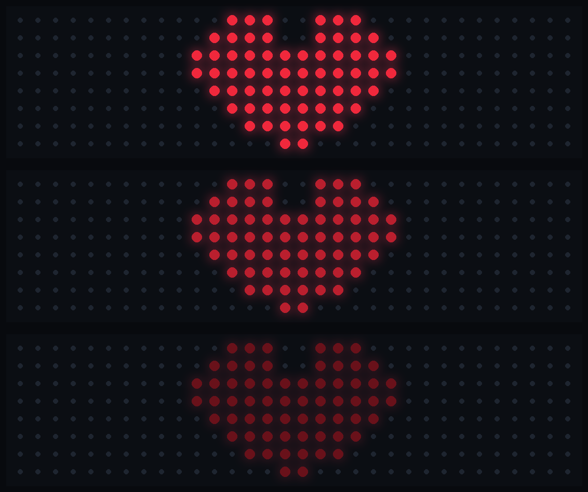

# 爱心点阵 · 8×32 LED Matrix Heart

用 Arduino UNO 点亮一块 8×32 的 MAX7219 点阵，做一颗会“咚—哒”跳动的心。
这是我从零开始的第一个 Arduino 项目。



👉 **交互式说明书**：[index.html](index.html)（接线图、实时动画预览、排错表、10 个后续实验）

| 项目信息 | |
|---|---|
| 主控 | Arduino UNO（ATmega328P，16 MHz） |
| 显示 | 8×32 MAX7219 点阵（4 片 8×8 级联，共 256 颗 LED） |
| 接线 | 5 根杜邦线 |
| 依赖 | Arduino 内置 SPI 库；无需另装第三方显示库 |
| 占用 | Flash 2076 B（6%）/ RAM 290 B（14%） |
| 效果 | 上电全亮 1 秒自检 → 一颗爱心按 1.1 秒周期“咚—哒”跳动 |
| 用时 | 约 4 小时（含 3 次推翻重来） |

---

## 快速开始

### 1. 接线（5 根）

| 点阵引脚 | 接到 UNO | 作用 |
|---|---|---|
| VCC | 5V | 供电（别接 3.3V） |
| GND | GND | 共地 |
| DIN | D11 | 数据输入（MOSI） |
| CS（有的印 LOAD） | D10 | 片选 |
| CLK | D13 | 时钟（SCK） |

> 改线前断电，按模块规格核对电压、极性和引脚；接反、短路或供电问题都可能损坏器件。

### 2. 上传

1. 打开 `heart_matrix/heart_matrix.ino`
2. 工具 → 开发板 → Arduino Uno
3. 工具 → 端口 → 选你的 COM 口
4. 点“上传”

### 3. 应该看到

全亮 1 秒（自检）→ 一颗完整、左右对称的爱心，亮度按“咚—哒—停—静”循环。

---

## 目录结构

```
.
├── README.md                    ← 你在这里
├── heart_matrix/
│   └── heart_matrix.ino         ← 主程序（Arduino 要求文件夹名 = 文件名）
├── index.html            ← 交互式说明书（浏览器打开，含实时预览）
├── preview.png                  ← 效果图
└── notes/
    ├── 01-learning-notes.md     ← 学习笔记（初学者向）
    ├── 02-troubleshooting.md    ← 错误指南（现象 → 原因 → 解决）
    └── 03-project-log.md        ← 项目记录（踩坑全过程）
```

---

## 三份文档

| 文档 | 内容 | 适合什么时候看 |
|---|---|---|
| [学习笔记](notes/01-learning-notes.md) | SPI、寄存器、级联、位运算、画布模型、转置、millis | 想搞懂“为什么这么写” |
| [错误指南](notes/02-troubleshooting.md) | 12 种常见现象 + 排查顺序 + 一个完整的排错案例 | 灯不对的时候 |
| [项目记录](notes/03-project-log.md) | 4 小时里 5 次假设、3 次推翻、最后怎么定位到根因 | 想抄作业 / 看过程 |

---

## 这个项目最大的坑

**这块点阵是“转置”接法的**：每片的 8 个寄存器（0x01–0x08）接的是 8 **行**，不是 8 列；每个字节的 8 个 bit 才是 8 列。

如果按“寄存器 = 列”写（多数 8×8 模块的接法），每一片都会把图像转置一遍，爱心会被斜着切成左右两块——**看起来像两块随机亮斑，而不是爱心**。

修法在 `show()` 里，发数据前转置：

```cpp
for (uint8_t r = 0; r < 8; r++) {            // 第 r 行
  uint8_t bits = 0;
  for (uint8_t b = 0; b < 8; b++) {          // 第 b 列
    if (canvas[c * 8 + b] & (1 << r)) bits |= (1 << b);
  }
  maxWrite(c, r + 1, bits);                  // 0x01~0x08 = 第 1~8 行
}
```

这个坑的完整排查过程写在[项目记录](notes/03-project-log.md)里。

---

## 网站入口

已作为 Spark 的日记中的真实项目导入。打开本目录的 index.html 查看交互说明；源码位于 heart_matrix/heart_matrix.ino。

## 用到的元器件

Arduino UNO ×1、8×32 MAX7219 点阵 ×1、杜邦线 5 根、USB 数据线 ×1。

其余（面包板、按键、蜂鸣器、各种传感器）都没用上——第一个项目越简单越好，能亮起来比什么都重要。

---

## 许可

代码和文档随便用（MIT 精神）：改成你自己的项目、贴到博客、当作业交，都行。
如果它帮你省了几个小时，在仓库点个 star 就行 :)
